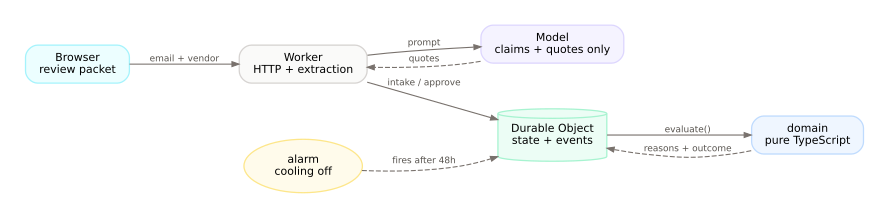
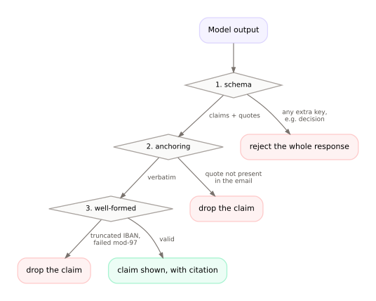

# payment-change-control

[English](README.md) · **日本語**

**モデルは何も承認できない** ドメインエージェントハーネス。


取引先から「振込先口座を変更したい」というメールが届く。ほとんどは定型だが、一部は詐欺だ。このシステムはモデルでメールを読み、決定論的なコードで判定し、2人の人間に承認を求める。評価関数には `approve` という結果が**存在しない**。ガードレールで囲っているのではなく、型にその値がない。したがって、モデルの出力から口座変更に至るコードパスは存在しない。

Cloudflare Workers + Durable Objects で動作。評価ケース30件、敵対的ミューテーション100件。CI はグリーン。



## なぜ

この判断に対する経理部門の統制は、たいてい規程と、不安そうな担当者ひとりだ。証拠はメールスレッドという非構造の場所にあり、真実はベンダーマスタという別の場所にあり、判断は二択なのにリスクは二択ではない。

本当の問題は「モデルがラベルを間違えた」ことではない。「モデルに判断を許し、人間がそれに従った」ことだ。だから設計から判断を取り除く。モデルは引用を出し、コードは検証し、人間が決める。

## 仕組み

**モデルが出せるのは主張と引用だけ。** スキーマは、判定・リスクスコア・承認を含む応答を丸ごと拒否する。該当フィールドだけを捨てるのではない。

**コードが引用をアンカーする。** モデルはオフセットを渡さない。サーバがメール本文から引用を探す。捏造・言い換えは原文に存在しないのでアンカーできない。値は整形済みであることも要求する（IBAN は ISO 13616 mod-97 を通ること）。

**コードがシグナルを検査する。** 送信元ドメインとベンダーマスタの照合（類似ドメインを含む）、Reply-To の不一致、コールバック番号が登録済みの番号と一致するか、直近の変更履歴、冷却期間。

**人間が承認する。** 48時間の冷却期間の後、重複しない2人の人間。下の権限表は、ゲートが実際に参照しているのと同じオブジェクトを UI が描画したもので、転記ではない。

| 決定                                     | 担当   |
| ---------------------------------------- | ------ |
| メールから主張を抽出する                 | モデル |
| 引用が原文どおりか検証する               | コード |
| 送信元ドメインをベンダーマスタと照合する | コード |
| コールバック番号が信頼できるか判定する   | コード |
| 冷却期間を強制する                       | コード |
| 変更を承認する                           | 人間   |
| 支払を実行する                           | 人間   |



## 試す

```sh
pnpm install
pnpm --filter @pcc/worker dev    # :8787
pnpm --filter @pcc/web dev       # :5173
```

http://localhost:5173 を開き、**Load demo data** を押してリクエストを開く。引用検証済みのスパンがハイライトされたメール、担当者タグ付きの検出項目、権限表、承認パネル、リプレイ、承認者ごとのレビュー証跡が表示される。

**Try to approve as the model** を押すと `403 authority_violation` が返る。

## 評価

```sh
pnpm --filter @pcc/worker evals              # 30件、オフライン抽出器
pnpm --filter @pcc/worker evals:adversarial  # 単一シグナルを変えた100件
EXTRACTION_API_KEY=... EXTRACTION_MODEL=gpt-6-luna \
  pnpm --filter @pcc/worker evals:model      # 同じケースを実モデルで
pnpm test:do                                 # 耐久性: アラーム、再起動、同時承認
```

実モデル（`gpt-6-luna`）の最新結果: **詐欺の突破 0/11、自動承認 0、引用の妥当性 100%、IBAN の再現率 100%**。ただしサンプルは小さい。30件では突破率の上限は約10%としか言えず、0%の証明にはならない。数字の意味と限界は [DESIGN.md §10](DESIGN.md)、実行結果は [EVALS-MODEL.md](EVALS-MODEL.md) を参照。

評価によって、モデルではなく**設計**のバグが2件見つかった。

1. 実モデルでの初回実行は **IBAN 再現率50%** だった。モデルが `"New IBAN: DE89 …"` のようにラベルごと引用し、値の検査がスパン全体を弾いていた。引用スパンの中から整形済みのトークンを取り出すよう修正した。
2. 敵対的テストで、IBAN を壊しても**登録済みの電話番号が本文に残っていれば承認可能**なままだった。有効なコールバック主張が1つあれば `escalate` に到達でき、口座の存在を要求していなかった。`claims.no_bank_details` ルールで修正した。

## これは何ではないか

- **詐欺防止ではない。** 不正な変更リクエストが承認されるのを防ぐ。スタックの他の場所での支払は止めない。
- **口座の所有確認ではない。** mod-97 は IBAN が整形済みであることしか示さない。Trustpair や Bottomline は銀行に問い合わせるが、このシステムは誰にも問い合わせない。[未解決の論点](DESIGN.md)を参照。
- **本番運用ではない。** 実メールの取り込み、マルチテナント、監視、利用者はいずれもない。

## ドキュメント

- [DESIGN.md](DESIGN.md) — 設計文書。先行事例、反対意見、評価が証明しないことまで含む
- [DEMO.md](DEMO.md) — 2分のデモ手順
- [EVALS.md](EVALS.md) / [EVALS-MODEL.md](EVALS-MODEL.md) — 評価レポート
- [docs/POST.md](docs/POST.md) — 経緯を読みたい人向けの記事
- [AGENTS.md](AGENTS.md) — コードが従うルール

図のソースは `docs/diagrams/*.dot`。`pnpm docs:diagrams` で再生成できる。

## スタック

TypeScript · Cloudflare Workers + Durable Objects (SQLite) · React + TanStack Router · 共有コントラクトに Effect v4 · Vitest · oxlint/oxfmt
