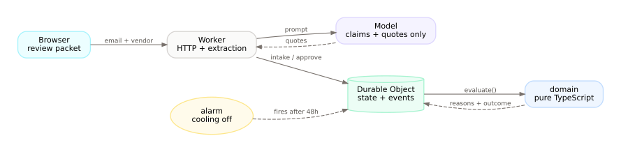
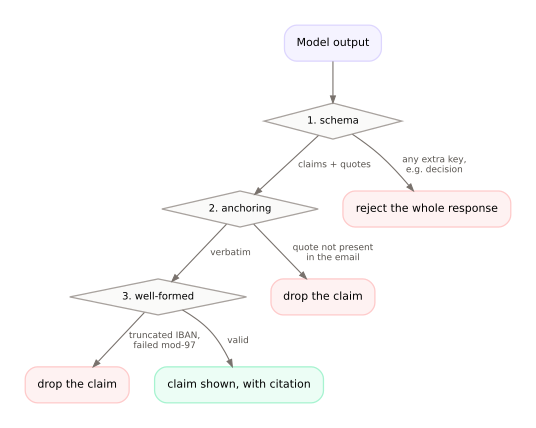

# payment-change-control

A domain agent harness where **the model cannot approve anything**.


A supplier emails asking to change its bank details. Most are routine; some are fraud. This
system reads the email with a model, decides with deterministic code, and requires two humans to
approve. The evaluator has no `approve` outcome — not a guardrail around one, but no such value
in the type — so there is no code path from a model output to a changed bank account.

Built on Cloudflare Workers and Durable Objects. 30 curated eval cases and 100 adversarial
mutations. CI green.



## Why

Accounts payable's control for this decision is usually a policy document and a worried clerk.
The evidence is unstructured (an email thread), the truth lives elsewhere (the vendor master),
and the decision is binary while the risk is not.

The failure that matters is not "the model picked the wrong label". It is "the model was
allowed to form a judgment, and a human deferred to it". So the design removes the judgment:
the model contributes quotes, code contributes checks, a human contributes the decision.

## How it works

**The model may only produce claims and quotes.** A strict schema rejects any response carrying
a verdict, a risk score, or an approval — the whole response, not just the offending field.

**Code anchors every quote.** The model does not supply offsets; the server locates the quote in
the email. A fabricated or paraphrased quote cannot be anchored, because it is not in the source.
Values must also be well-formed: an IBAN has to pass ISO 13616 mod-97.

**Code checks the signals.** Sender domain against the vendor master (including lookalikes),
Reply-To mismatch, callback number must match the one on file, recent-change flag, cooling-off.

**A human approves.** Two distinct humans, after a 48-hour cooling-off period. The authority
table below is the same exported object the gate enforces — the UI renders it, it is not a
transcription.

| Decision                                    | Owner |
| ------------------------------------------- | ----- |
| Extract claims from the email               | model |
| Verify a citation is verbatim               | code  |
| Compare sender domain to the vendor master  | code  |
| Decide whether a callback number is trusted | code  |
| Enforce the cooling-off period              | code  |
| Approve the change                          | human |
| Release payment                             | human |



## Try it

```sh
pnpm install
pnpm --filter @pcc/worker dev    # :8787
pnpm --filter @pcc/web dev       # :5173
```

Open http://localhost:5173, press **Load demo data**, and open a request. You get the email with
citation-checked spans highlighted, the findings with their owners, the authority table, an
approval panel, replay, and the review evidence recorded for each approver.

**Try to approve as the model** returns `403 authority_violation`.

## Evals

```sh
pnpm --filter @pcc/worker evals              # 30 cases, offline extractor
pnpm --filter @pcc/worker evals:adversarial  # 100 single-signal mutations
EXTRACTION_API_KEY=... EXTRACTION_MODEL=gpt-6-luna \
  pnpm --filter @pcc/worker evals:model      # same cases, real model
pnpm test:do                                 # durability: alarm, restart, concurrency
```

Latest real-model run (`gpt-6-luna`): **0 / 11 fraud escapes, 0 auto-approvals, 100% citation
validity, 100% IBAN recall**. The sample is small — 30 cases bounds the escape rate at roughly
10%, not zero. See [DESIGN.md §10](DESIGN.md) for what the numbers do and do not support, and
[EVALS-MODEL.md](EVALS-MODEL.md) for the run.

The evals found two real bugs, both in the design rather than the model:

1. The first real-model run scored **50% IBAN recall** because the model quoted
   `"New IBAN: DE89 …"` and the value check rejected the whole span. Fixed by extracting a
   well-formed token from inside the cited span.
2. The adversarial suite found that a corrupted IBAN in an email that also contained the on-file
   phone number stayed **approvable** — one valid callback claim was enough. Fixed with a
   `claims.no_bank_details` rule.

## What this is not

- **Not fraud prevention.** It stops a fraudulent change request from being approved. It does not
  stop a payment elsewhere in the stack.
- **Not ownership verification.** Mod-97 proves an IBAN is well-formed, not that the supplier owns
  it. Trustpair and Bottomline ask the bank; this asks nobody. See [open questions](DESIGN.md).
- **Not production ready.** No real email ingestion, no multi-tenancy, no monitoring, no users.

## Docs

- [DESIGN.md](DESIGN.md) — the design doc, including prior art, the counter-position, and what
  the evals do not prove
- [DEMO.md](DEMO.md) — a two-minute walkthrough
- [docs/POST.md](docs/POST.md) — the write-up, for people who want the narrative
- [EVALS.md](EVALS.md) / [EVALS-MODEL.md](EVALS-MODEL.md) — eval reports
- [AGENTS.md](AGENTS.md) — the rules the code follows

Diagram sources are in `docs/diagrams/*.dot`; regenerate with `pnpm docs:diagrams`.

## Stack

TypeScript · Cloudflare Workers + Durable Objects (SQLite) · Hono-free plain routing ·
React + TanStack Router · Effect v4 in the shared contracts package · Vitest · oxlint/oxfmt.
